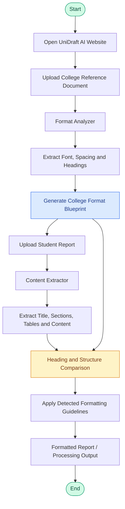
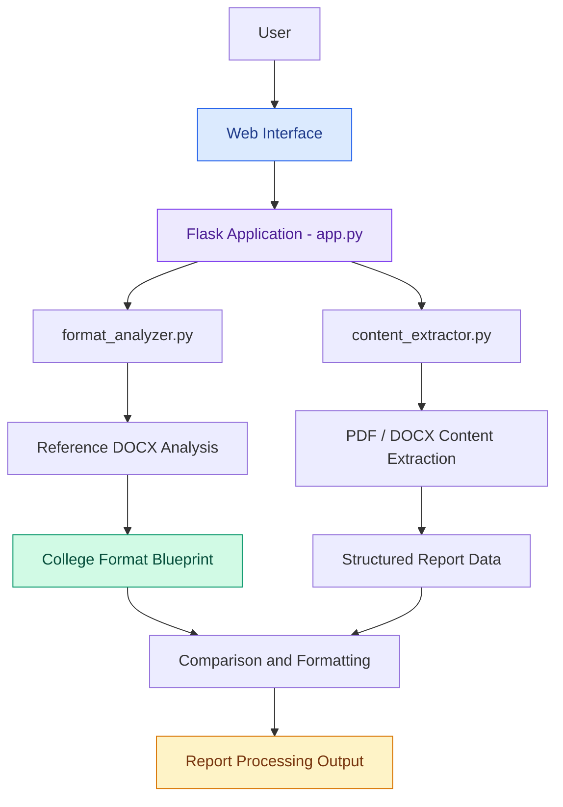

# 🎓 UniDraft AI – Intelligent Academic Report Formatter

<p align="center">

**Transform your academic reports into professionally formatted documents with the power of automation.**

An intelligent document analysis and formatting system that understands college formatting guidelines and helps students prepare reports according to institutional standards.

</p>

<p align="center">


</p>

---

## ✨ 1. Overview

**UniDraft AI** is a Python-based intelligent academic report analysis and formatting web application designed to simplify the process of preparing college project reports.

Students often struggle to format their academic reports according to specific college guidelines. Manually checking font styles, font sizes, heading structures, spacing, and document layouts can be time-consuming.

UniDraft AI aims to solve this problem through automated document analysis.

The system analyzes a college reference document, identifies its formatting preferences, extracts the content and structure of a student's report, and uses the detected guidelines to support consistent report formatting.

### 🎯 2. Problem Statement

Traditional academic report formatting involves:

- Manually checking college formatting guidelines.
- Identifying the correct font family and font size.
- Maintaining consistent heading styles.
- Managing paragraph spacing and line spacing.
- Arranging report sections according to the required structure.
- Repeating formatting changes throughout the document.

These tasks increase the time and effort required to prepare academic reports.

### 💡 3. Proposed Solution

UniDraft AI provides an automated approach by:

1. Accepting a college reference document.
2. Analyzing its formatting characteristics.
3. Generating a College Format Blueprint.
4. Accepting the student's report.
5. Extracting its content and document structure.
6. Comparing the report structure with the detected guidelines.
7. Supporting consistent formatting based on the analyzed reference.

---

## 🚀 4. Key Features

| Feature | Description |
|---|---|
| 📄 Document Upload | Upload reference documents and student reports. |
| 🔍 Format Analysis | Analyze college formatting preferences. |
| 🔠 Font Detection | Identify font family and font size. |
| 📐 Spacing Analysis | Detect line spacing and formatting properties. |
| 📚 Heading Detection | Identify document headings and hierarchy. |
| 📝 Content Extraction | Extract titles, sections, and report content. |
| 📊 Format Blueprint | Generate a structured college formatting blueprint. |
| 🔄 Heading Comparison | Compare report headings with reference structures. |
| 📑 Document Processing | Process PDF and DOCX documents. |

---

## 🔄 5. How UniDraft AI Works

The application follows a two-document analysis workflow.

**Step 1 – Upload College Reference**

The user uploads the college's sample report or reference document.

**Step 2 – Analyze Formatting Guidelines**

The system analyzes the document to identify:
- Font family and font size.
- Line spacing.
- Heading hierarchy.
- Other available formatting properties.

**Step 3 – Generate College Format Blueprint**

The detected formatting preferences are organized into a structured blueprint.

**Step 4 – Upload Student Report**

The student uploads their own academic report.

**Step 5 – Extract Report Content**

The system extracts:
- Report title.
- Section headings.
- Paragraph content.
- Tables.
- Headers and footers.
- Page information.

**Step 6 – Compare Document Structure**

The extracted report structure is compared with the detected reference guidelines.

**Step 7 – Formatting Workflow**

The analyzed guidelines and extracted content are used to support the report formatting process.

---

## 🏗️ 6. System Architecture & Working Flow

### Overall System Workflow



### Internal Processing Architecture



---

## 🛠️ 7. Technology Stack

| Technology | Purpose |
|---|---|
| Python | Core application development |
| Flask | Backend web framework |
| PyMuPDF (fitz) | PDF document processing |
| python-docx | DOCX document processing |
| HTML5 | Web page structure |
| CSS3 | User interface styling |
| JavaScript | Frontend interactions |
| Werkzeug | Secure file handling utilities |

---

## 📂 8. Project Structure

```text
UniDraft-AI/
│
├── app.py
│
├── format_analyzer.py
│
├── content_extractor.py
│
├── templates/
│   ├── index.html
│   ├── upload.html
│   └── result.html
│
├── static/
│   ├── css/
│   │   └── style.css
│   │
│   ├── js/
│   │   └── script.js
│   │
│   └── images/
│
├── uploads/
│
├── requirements.txt
│
├── .gitignore
│
└── README.md
```

---

## ⚙️ 9. Installation & Setup

Follow these steps to run UniDraft AI locally.

### Prerequisites

- Python 3.x
- Visual Studio Code
- Git
- Web browser

### Step 1: Clone the Repository

```bash
git clone https://github.com/AzkaaMulla/UniDraft-AI.git
```

### Step 2: Navigate to the Project

```bash
cd UniDraft-AI
```

### Step 3: Create a Virtual Environment

```bash
python -m venv venv
```

### Step 4: Activate Virtual Environment

**Windows:**

```bash
venv\Scripts\activate
```

### Step 5: Install Dependencies

```bash
pip install flask pymupdf python-docx
```

### Step 6: Run the Application

```bash
python app.py
```

### Step 7: Open in Browser

```text
http://127.0.0.1:5000/
```

---

## 🧪 10. Example Working Scenario

Consider a student who needs to prepare a project report according to their college's formatting guidelines.

**Input Documents**

| Document | Purpose |
|---|---|
| College Reference.docx | Contains the college's formatting standards |
| Student Report.pdf | Contains the student's academic report |

**Example Analysis Output**

```text
========== COLLEGE FORMAT BLUEPRINT ==========

Font Family       : Times New Roman
Body Font Size    : 14 pt
Line Spacing      : 1.5
Heading Analysis  : Completed

==============================================
```

**Example Extracted Report**

```text
========== EXTRACTED REPORT ==========

Title:
SMART CAMPUS ATTENDANCE SYSTEM

Sections:
1. INTRODUCTION
2. PROBLEM STATEMENT
3. OBJECTIVES
4. SYSTEM DESIGN

Content Extraction: Successful

======================================
```

This demonstrates how the application processes the reference document and the student's report separately before using the analyzed information in its formatting workflow.

---

## 🔮 11. Future Enhancements

The following features are planned to improve the application:

- AI-powered intelligent heading recognition.
- Automatic detection of previously unseen headings.
- Advanced document formatting.
- Automatic table of contents generation.
- Page numbering and margin adjustment.
- Support for additional document formats.
- Improved formatting validation.
- Downloadable formatted reports.
- More advanced AI-based document structure analysis.

---

## 🎯 12. Project Objectives

- Reduce manual academic report formatting efforts.
- Improve consistency in academic documentation.
- Automate college guideline analysis.
- Simplify document structure extraction.
- Provide students with an easier report preparation experience.

---

## 👩‍💻 13. Developer

**Azkaa Mulla**

---

<p align="center">

### ✨ UniDraft AI

**Write Better. Format Smarter. Submit with Confidence.**

*Making academic report preparation simpler and smarter.*

</p>
